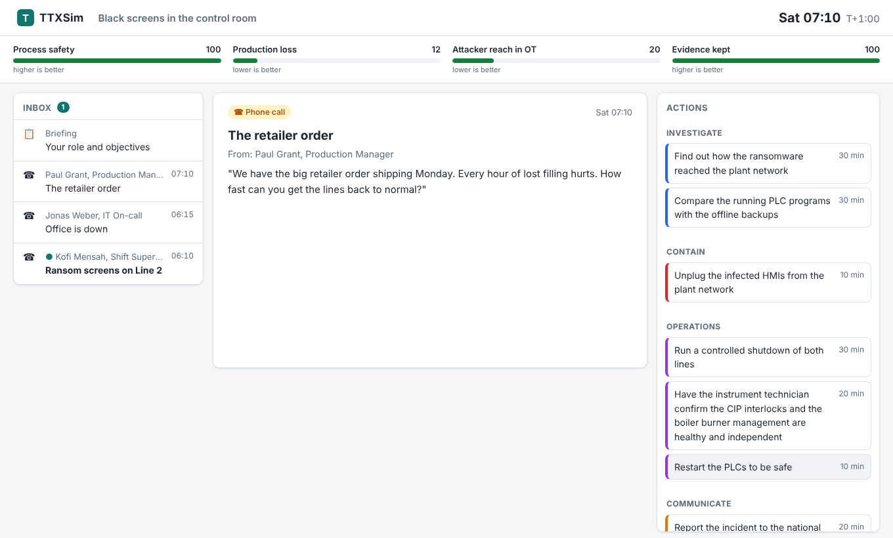

# TTXSim

**An incident response tabletop exercise simulator for the browser and the terminal.**

**[Play it in your browser](https://sdtslmn.github.io/ttxsim/)**, with nothing to install.

Each scenario drops you into an incident at a fictional organization. Emails,
alerts and phone calls arrive on a clock. Every action takes time, and the
situation keeps changing while you work: an attacker keeps moving, money keeps
leaving, a manager wants the plant restarted. When it ends you get a scored
debrief and a Markdown after-action report, with your actions mapped to NIST
CSF 2.0 categories as used in NIST SP 800-61r3.



## The scenarios

| # | Scenario | Level | Setting | What it's about |
| --- | --- | --- | --- | --- |
| 1 | The click | Beginner | Logistics | A fake sign-in page captured a password and a live session |
| 2 | Left on the train | Beginner | Healthcare | A lost, unencrypted laptop and the four-hour privacy clock |
| 3 | One red alert | Beginner | Professional services | A macro dropper: isolate, keep evidence, find the spread |
| 4 | The new bank details | Intermediate | Food distribution | Invoice fraud: bank recall first, then the compromised mailbox |
| 5 | Files with a new extension | Intermediate | Engineering | File server ransomware, backups and a clean restore |
| 6 | The bill that jumped | Intermediate | Software | A leaked cloud access key, crypto mining and a backdoor user |
| 7 | The resignation | Intermediate | Robotics | A departing engineer exfiltrating designs, handled by the book |
| 8 | Black screens in the control room | OT | Beverage plant | Office ransomware crossing into the plant HMIs |
| 9 | The cursor moved | OT | Water treatment | A remote chemical dosing change at a water plant |
| 10 | The safety system tripped | OT | Gas processing | A SIS trip with the controller in program mode |
| 11 | The vendor at 3 a.m. | OT | Gas transmission | A compromised vendor remote access account |
| 12 | Breakers that open themselves | OT | Electricity transmission | Rogue IEC-104 commands from a substation computer, and a second implant |
| 13 | The fence at Pump Station 7 | OT | Water transmission | A break-in at an unmanned site, a rogue device and a fake phone call |
| 14 | Through the historian | OT | Power and desalination | An IT to OT pivot over a shared historian account |
| 15 | Three days | Capstone | Port services | Double extortion over three days: recovery, customers, press, regulator, board |

All organizations, people and events are fictional.

The OT scenarios also have:

- **Discussion points** that pause the clock in your head: a short "earlier
  warning signs" look back, then questions at the moments that matter. Notes
  you write go into the report.
- **Plant status** next to the measures: whether the path is open, what the
  safety system is doing, whether the PLC logic is trusted.
- **The attack path** in MITRE ATT&CK for ICS terms, linked to each technique.
- **Settings** you can change before you start, such as the organization
  name or whether offline golden images exist. Some change how the scenario
  plays out.
- **Variation.** Four of them change from run to run (where the second
  implant sits, how the attacker got in), and some messages may or may not
  arrive. Each run has a number, so another group can get the same run.

## How it plays

- **Injects arrive on a clock.** The briefing tells you who you are. Messages
  come in at set times, or when something you did (or didn't do) triggers them.
- **Every action takes time.** Calling someone takes ten minutes, imaging a
  disk takes 45, rebuilding a domain takes twelve hours. The world moves while
  you work, so the order matters.
- **Measures show the state of things.** Attacker reach, evidence kept,
  process safety, money recoverable and so on. They move with your decisions
  and with time.
- **Some choices are traps.** Pulling the plug, reimaging too early,
  replying to the fraudster, restarting PLCs "to be safe". The debrief explains
  why.
- **You're scored on objectives.** They're listed from the start. At the end
  each one is marked hit or missed, with an explanation.

Actions are grouped the way a responder thinks about them, and each group maps
to a NIST CSF 2.0 category in the report:

| Group | CSF 2.0 category |
| --- | --- |
| Investigate | RS.AN Incident Analysis |
| Contain, Operations | RS.MI Incident Mitigation |
| Communicate | RS.CO Incident Response Reporting and Communication |
| Coordinate | RS.MA Incident Management |
| Recover | RC.RP Incident Recovery Plan Execution |

## Run it on your computer

You need Node.js 20.19 or newer.

```
git clone https://github.com/sdtslmn/ttxsim.git
cd ttxsim
npm install
npm run sim          # terminal version
npm run dev:web      # browser version on http://localhost:5173
```

`npm test` runs the tests and `npm run validate-scenarios` checks that every
scenario's own solution scores 100% and that doing nothing fails, for every
combination of settings and variants.

### The terminal version

```
ttx> play 9
ttx> actions
Investigate
   1. Export the remote tool's connection log and the HMI audit trail (15 min)
   2. Check how the plant network is exposed to the internet (30 min)
Contain
   3. Stop the remote desktop tool on all plant computers and block it at the firewall (5 min)
...
ttx> do 3
ttx> wait
ttx> status
```

| Command | What it does |
| --- | --- |
| `scenarios`, `play <n>` | List and start scenarios |
| `setup <n>` | Show the settings a scenario takes |
| `play 8 org="Acme Foods" golden_images=no run=4821` | Start with your own settings and a fixed run |
| `load <file.yaml>` | Start your own scenario |
| `inbox`, `read [n]` | See and read messages |
| `actions`, `do <n>` | See and take actions |
| `wait [30m\|1h]` | Let time pass; on its own, waits for the next message |
| `discuss`, `note <text>` | Show the current discussion questions, record your answer |
| `status`, `log`, `brief` | Measures and objectives, timeline, briefing |
| `end`, `report [file]` | Finish now, save the after-action report |
| `map [n]` | The scenario map, with your path marked after an exercise |
| `feedback` | Optional AI feedback on your notes (needs `ANTHROPIC_API_KEY`) |

For team play in the terminal:

| Command | What it does |
| --- | --- |
| `team lead=Sara ops=Omar security comms` | Seat a team by role |
| `do 3 by=lead because the path is still open` | Record who made the call and why |
| `vote 2=5 4=1 because ...` | Record a show of hands; the option with most votes is taken |
| `push`, `push <n>` | List the optional injects, push one now |
| `push "Subject" "Message" from="Plant manager"` | Send an inject you write on the spot |
| `msel <n> [file.md\|file.csv] [run=4821]` | Save the master scenario events list |

## Write your own scenario

Scenarios are plain YAML files. A small condition language decides when
messages arrive, which actions are available and which objectives you hit:

```yaml
injects:
  - id: fraud_report
    when: attacker_active and not sessions_revoked and time >= at.active_alert + 45m
    from: Lena Fischer, Baltic Cargo Partners
    via: email
    subject: "Re: Updated bank details"
    body: We received a message from Priya asking us to change bank details...
    effects:
      set: [fraud_sent]
      trust: -25
```

Scenarios can also have discussion points, status indicators, an attack path,
settings for the facilitator, optional injects and random variants.

Load your file in the browser with **Load a scenario file** (it never leaves
your browser), or in the terminal with `load my-scenario.yaml`. Check it with:

```
npm run validate-scenarios -- my-scenario.yaml
```

The full reference is in [docs/scenario-format.md](docs/scenario-format.md).
This is the easiest way to build exercises around your own organization,
systems and playbooks.

## Running it with a team

Pick **Run with a team** on any scenario. The setup screen asks which seats
you have at the table (incident lead, operations, security, engineering,
safety, communications, legal, executive) and, for the OT scenarios, lets you
tailor the scenario to your site.

During the exercise:

- **Every decision gets a reason.** Clicking an action asks who made the call
  and why, before the clock moves. Those reasons are what the hot wash is
  about later.
- **Put options to a vote.** Pick two to four actions, take a show of hands
  and enter the counts. Split votes are flagged in the report.
- **Push injects when the room needs it.** The facilitator panel lists
  optional injects for the scenario, each with a note on when to use it,
  plus pressure injects that fit any scenario: a reporter calling, the CEO
  wanting a yes or no, a key person who can't be reached. You can also write
  one on the spot.
- **Presenter view** makes the text bigger for a projector. Fold the
  facilitator panel away before you project, because its notes are spoilers.

Before the session, open **Map and MSEL** for the scenario. The map shows the
model response, the traps and what happens when steps are skipped. The MSEL
(master scenario events list) is a facilitator script in Markdown or CSV for
Excel, with the expected player actions, the contingent injects, the
discussion questions and the optional injects. If the scenario varies, start
it from the map page or with the same run number, so the MSEL matches what
the players see.

At the end, download the after-action report. It has the seats, every
decision with its reason and vote, the injects you pushed, the discussion
notes and the team's path against the model path.

## Optional AI feedback

After an exercise you can ask Claude for feedback on your discussion notes
and decisions. It's off unless you ask for it, and it uses your own Anthropic
API key:

- In the browser, paste the key in the box on the debrief page. It stays in
  the page while it's open and is never saved.
- In the terminal, set `ANTHROPIC_API_KEY` and type `feedback`. Set
  `TTXSIM_MODEL` to use a different model.

What's sent: the scenario summary, your timeline, objectives, decisions and
notes. The feedback is added to the report you download. Treat it as a second
opinion for the hot wash, not a verdict.

## How close to reality is it?

Close enough to practise decisions, simple enough to finish in half an hour:

- Time, consequences and scoring are designed for teaching, not prediction.
  Real incidents are messier and slower.
- The organizations, regulations and deadlines in the scenarios are
  fictional, though they're modelled on common real-world rules (for example a
  72-hour breach notification window).
- Standards are referenced for orientation. TTXSim is a training tool. It's not
  a compliance or assessment tool, and it doesn't replace your own incident
  response plan or legal advice.

See [docs/roadmap.md](docs/roadmap.md) for what's coming next, and
[CONTRIBUTING.md](CONTRIBUTING.md) to add a scenario.

## License

Apache License 2.0. See [LICENSE](LICENSE) and [NOTICE](NOTICE).
